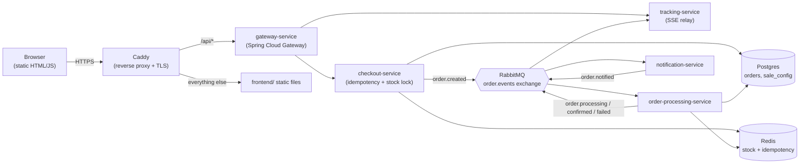

# Flash Sale System

[](https://github.com/CodingToLive/flash-sale-engine/actions/workflows/ci.yml)
[](https://github.com/CodingToLive/flash-sale-engine/actions/workflows/deploy.yml)

A high-concurrency flash-sale backend: a gateway, a checkout service that can
never oversell or double-charge under load, a RabbitMQ broker that decouples
the purchase from its async processing, and a notification service - plus a
live demo page that visibly tracks a single request through all five services
in real time, and buttons that fire real concurrent traffic at the backend to
prove the concurrency-safety claims instead of just asserting them.

**Live demo:** `https://<your-subdomain>.duckdns.org` _(fill in once deployed - see
[infra/oracle-vm-setup.md](infra/oracle-vm-setup.md))_

## Architecture



Five backend services, not the four literally named in the brief - flagged
deliberately:

- **gateway-service** - single public entry point: routing, per-IP rate
  limiting on the checkout path, request-id propagation.
- **checkout-service** - the concurrency-safety core (see below). Returns
  `202 Accepted` immediately; nothing downstream blocks the caller.
- **order-processing-service** - the async step the broker actually decouples
  checkout from: simulates fulfillment, confirms or fails the order.
- **notification-service** - renders a notification payload and publishes it;
  real email delivery is opt-in only (see "Notifications" below).
- **tracking-service** - a pure event listener/relay with no writes and no
  business logic. It subscribes to the same `order.events` exchange every
  other service already publishes to and re-emits those events to the browser
  over SSE, which is what drives the live pipeline animation on the demo page.
  Because it can't write anything, it can't introduce a correctness bug into
  the purchase flow - it's additive, not load-bearing.

## Highlights

- **Atomic stock decrement.** A single Redis Lua script does
  `GET → compare → DECRBY` as one atomic operation, so concurrent buyers can
  never push stock below zero - proven by a Testcontainers test that hammers
  500 concurrent virtual threads against a stock of 100 and asserts exactly
  100 succeed (`checkout-service`'s
  `StockAndIdempotencyServiceConcurrencyTest`).
- **Defense-in-depth idempotency.** A Redis `SETNX` lock is the fast path (a
  duplicate request never even reaches Postgres); a Postgres `UNIQUE` constraint
  on `idempotency_key` with `ON CONFLICT DO NOTHING` is the second, independent
  safety net in case the Redis lock were ever bypassed or lost. Both are
  covered by their own concurrency tests.
- **Idempotent consumers, not just idempotent producers.** RabbitMQ is
  at-least-once delivery; `order-processing-service` guards its status update
  with `WHERE status = 'PENDING'`, so a redelivered message becomes a no-op
  instead of double-processing.
- **Dead-letter handling.** Each queue is configured with a dead-letter
  exchange; Spring Retry gives a failing consumer three attempts before the
  message is routed to a DLQ instead of being lost or retried forever.
- **Java 21 virtual threads** on the checkout/processing/notification
  services (`spring.threads.virtual.enabled=true`) - a concrete, idiomatic
  high-concurrency story without reaching for a fully reactive stack.
- **A live pipeline you can actually watch.** Every hop (`CREATED` →
  `PROCESSING` → `CONFIRMED`/`FAILED` → `NOTIFIED`) is a real RabbitMQ message,
  relayed to the browser over SSE as it happens - not a client-side animation
  timed to guess server latency.
- **Full CI/CD.** GitHub Actions builds and tests every PR (including the
  Testcontainers tests above, against a real throwaway Postgres/Redis), then
  on merge to `main` builds `linux/arm64` images, pushes them to GHCR, and
  SSHes into the deployment VM to roll them out.

## Notifications

Real email delivery is **off by default**. `notification-service` still does
real work - it builds the subject/body for the order outcome - but by default
it only publishes that payload for `tracking-service` to show as an in-page
"notification preview" card. No visitor's email address is ever required to
run the demo.

There's an opt-in path: a visitor can supply their own email in the "Buy Now"
flow, which is propagated through to `notification-service`. If
`EMAIL_ENABLED=true` and a dedicated transactional-email provider's SMTP
credentials are configured (via `SMTP_*` env vars - deliberately not hardcoded
to any one vendor, and never the maintainer's personal inbox), exactly one
real email is sent per order, rate-limited to one send per 60 seconds overall.
That rate limit is what keeps the "simulate traffic spike / duplicate" buttons
from ever being able to trigger a burst of real SMTP sends.

## Running locally

Requires Docker and Docker Compose.

```bash
git clone https://github.com/CodingToLive/flash-sale-engine.git
cd flash-sale-engine
docker compose up --build
```

Then open **http://localhost:18080** - Caddy serves the frontend and proxies
`/api/*` to the gateway, the same arrangement production uses. The RabbitMQ
management UI is at http://localhost:15672 (guest/guest) if you want to watch
queues fill and drain while a simulation runs.

To iterate on a single service without rebuilding everything in Docker, bring
up just the infra and run the service with Maven:

```bash
docker compose up -d postgres redis rabbitmq
./mvnw -pl checkout-service spring-boot:run
```

### Running the tests

```bash
./mvnw verify
```

This runs the unit tests plus the Testcontainers-backed concurrency tests
described above - the suite that actually backs the "no overselling, exactly
once" claims, not just manual observation. It needs Docker running locally,
same as CI.

## Deploying

See [infra/oracle-vm-setup.md](infra/oracle-vm-setup.md) for the one-time
Oracle Cloud "Always Free" VM setup (the only manual step), and
[.github/workflows/deploy.yml](.github/workflows/deploy.yml) for what runs
automatically afterward on every push to `main`.

## Why these choices

- **RabbitMQ over Kafka** - Kafka's JVM + ZooKeeper/KRaft footprint is a tight
  fit on a free-tier VM's RAM; RabbitMQ gives the same decoupling story at a
  fraction of the resource cost, with a management UI that's genuinely useful
  for demoing.
- **Oracle Cloud free-tier VM over a PaaS free tier** - Render/Fly/Railway's
  free tiers sleep or cap long-running multi-container stateful stacks, which
  would break a "click Buy Now and watch it happen live" demo. Oracle's
  Always-Free Ampere A1 VM (4 OCPU/24 GB RAM) runs the whole stack - broker
  included - 24/7 for $0.
- **One shared Postgres instance/schema** rather than database-per-service -
  a deliberate simplification for lower cost and simpler ops on a single VM,
  traded against strict microservice purity. Worth calling out as "what I'd
  change with more time" rather than pretending it's not a trade-off.
- **tracking-service's in-memory SSE sinks** don't scale past a single
  instance - fine since the whole stack runs on one VM today; Redis Pub/Sub
  would be the natural fix if this ever needed to run on more than one
  tracking-service replica.

## License

MIT
